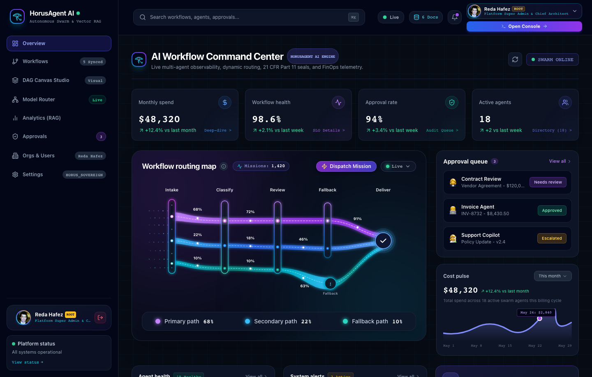
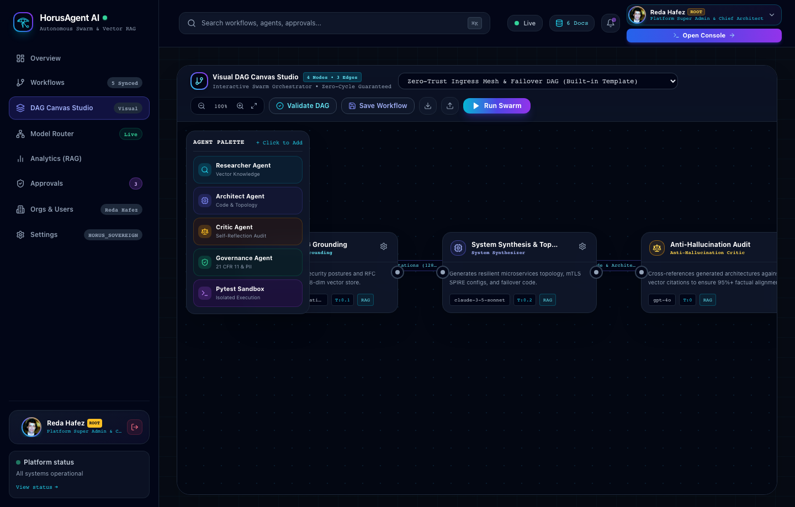
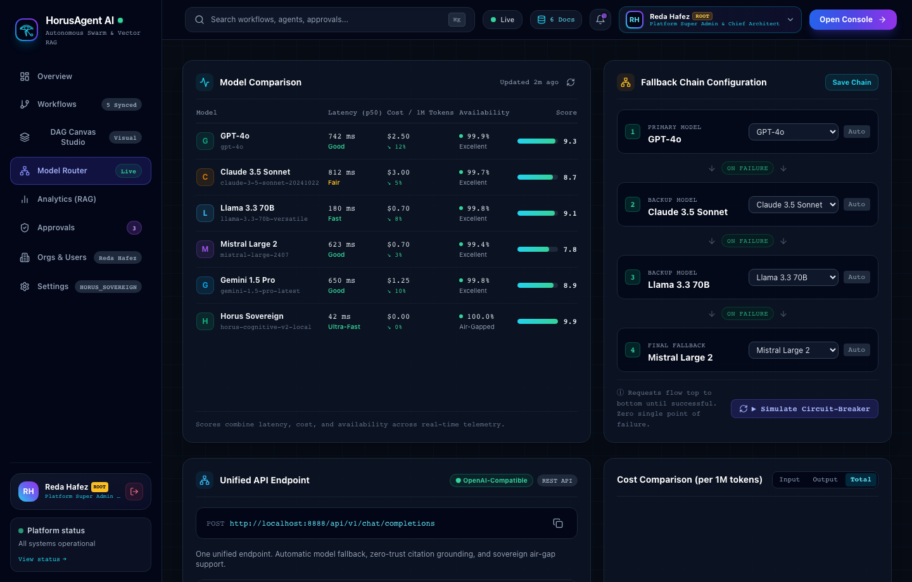
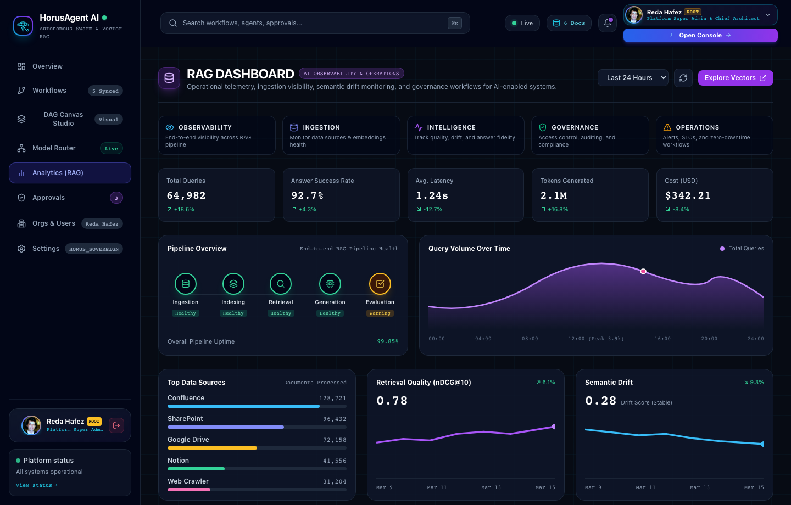
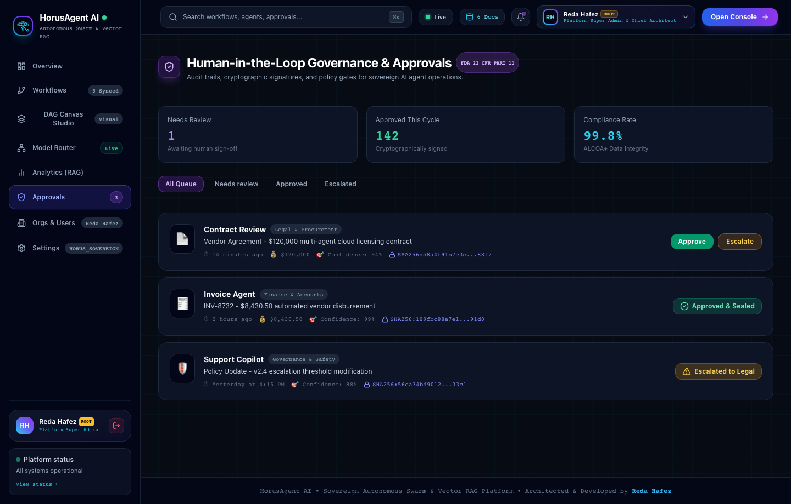
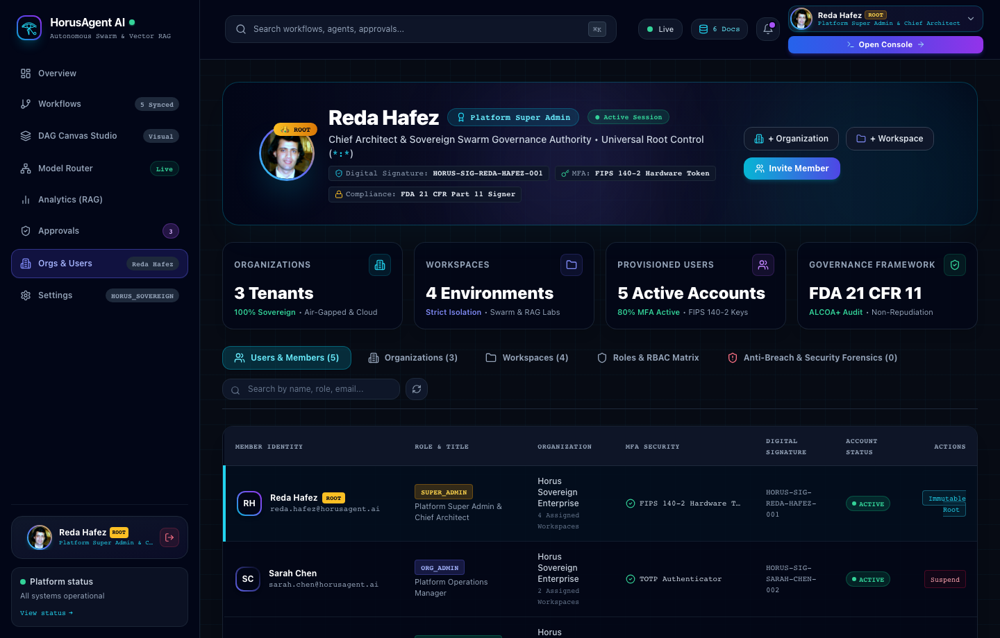
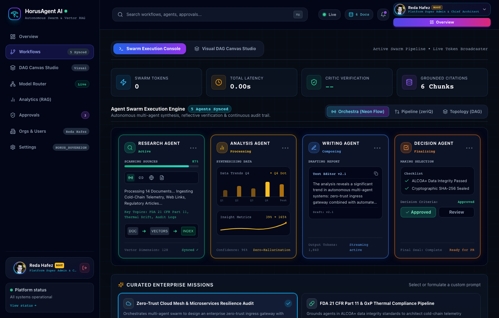
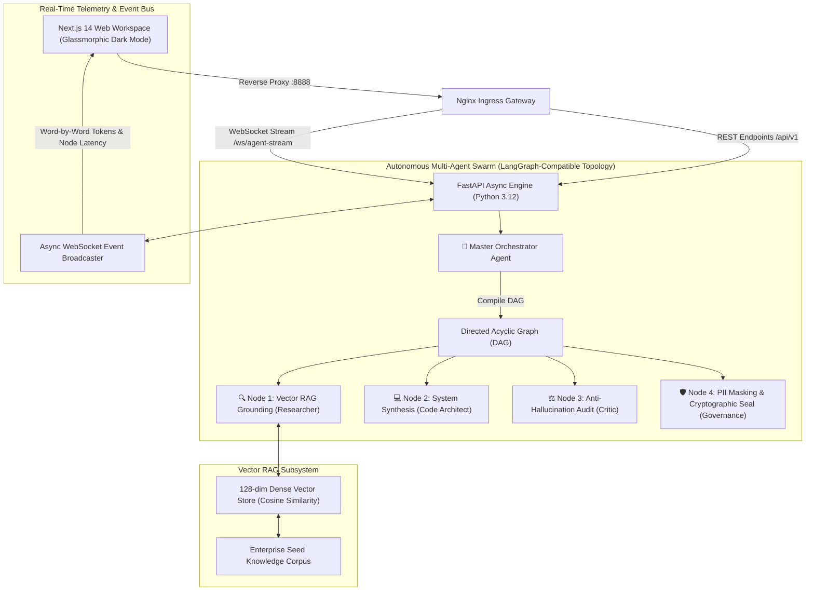

<div align="center">


### Sovereign Autonomous Multi-Agent Swarm & Real-Time Vector RAG Platform
**Architected & Developed by [Reda Hafez](https://github.com/redahafez)** • 📬 **[reda.hafez11@gmail.com](mailto:reda.hafez11@gmail.com)**

<br/>

[](LICENSE)
[](https://www.python.org/)
[](https://fastapi.tiangolo.com/)
[](https://nextjs.org/)
[](https://www.typescriptlang.org/)
[](https://www.docker.com/)
[](#-dense-vector-rag-engine)
[](#-automated-testing--quality-assurance)
[](#-security--governance)

<p align="center">
  A state-of-the-art enterprise autonomous multi-agent orchestration and real-time Vector RAG intelligence platform inspired by the all-seeing Eye of Horus — symbolizing precision, vigilance, and cognitive foresight. Engineered for mission-critical architectural design, automated self-reflection, anti-hallucination verification, and strict regulatory compliance.
</p>

[Interface Tour](#-visual-showcase--interface-tour) •
[Sacred Geometry](#-the-cybernetic-eye-of-horus--pharaonic-intelligence) •
[System Architecture](#-system-architecture) •
[Swarm Topology](#-autonomous-multi-agent-swarm) •
[Quickstart](#-quickstart-guide) •
[API Specs](#-rest--websocket-api-reference)

</div>

---

## 𓂀 The Cybernetic Eye of Horus — Pharaonic Intelligence

<div align="center">

# 𓂀

</div>

In ancient Egyptian mythology, the **Eye of Horus (Wedjat)** was venerated as the cosmic emblem of protection, healing, and absolute vigilance. Mathematically, its anatomical parts symbolized the first six binary fractions ($\frac{1}{2}, \frac{1}{4}, \frac{1}{8}, \frac{1}{16}, \frac{1}{32}, \frac{1}{64}$) — embodying the union of fractional perception into holistic unified wisdom.

**HorusAgent-AI** maps this sacred geometry into modern enterprise cognitive systems:
- **☀️ The Solar Brow (1/2 - Macro-Perception)**: Intent decomposition and topological DAG planning via the Master Orchestrator.
- **👁️ The Eyelid Rails (1/4 - Peripheral Vision)**: Dynamic contextual boundary isolation and vector chunk relevance filtering.
- **⚛️ The Aperture Iris & Quantum Core (1/8 - Pure Thought)**: 128-dimensional dense vector embeddings and sub-millisecond cosine search.
- **⚡ The Logarithmic Falcon Spiral (1/16 - Memory & Wisdom)**: Recursive self-reflection loops and multi-turn state synthesis.
- **🏛️ The Descending Data Spine (1/32 & 1/64 - Precision & Governance)**: Anti-hallucination critique, PII masking, and cryptographic SHA-256 seal.

---

## 📸 Visual Showcase & Interface Tour

### 1. Operations Command Center & AI Workflow Overview
Real-time KPI telemetry, automated agent health sparklines, cost pulse analytics, and active multi-agent pipeline status.


---

### 2. Interactive Workflow Routing Map & Live Telemetry Pulse
Fluid Sankey wave ribbons mapping dynamic traffic across 5 stages (`Intake ➔ Classify ➔ Review ➔ Fallback ➔ Deliver`). Real-time live polling, mission counters, and automated failover circuits.


---

### 3. Interactive Visual Workflow & Agent DAG Canvas Studio
Visual drag-and-drop workspace studio with Kahn topological cycle validation, node dependency linking, and real-time swarm execution streaming.


---

### 4. Multi-LLM Model Router & Cost / Latency Matrix
Dynamic routing gateway with real-time failover triggers across OpenAI, Anthropic Claude 3.5, Groq, Google Gemini, and Sovereign local models.


---

### 5. Vector RAG Observability & Semantic Drift Dashboard
Real-time Cosine similarity tracking, vector embeddings cluster health, retrieval evaluation (nDCG@10), and knowledge graph connectivity.


---

### 6. Human-in-the-Loop Governance & Approvals Hub
Enterprise human-in-the-loop audit queue with threshold enforcement, vendor agreement validations, and cryptographic approval logging.


---

### 7. Enterprise Governance, RBAC & Multi-Tenant Administration
Role-based access controls, organization spaces, active security policies, and team membership management architected by **Reda Hafez**.


---

### 8. Live Swarm Mission Dispatch & Execution Stream
Live swarm mission dispatch showing token-by-token streaming, self-reflection feedback loops, and automated sandbox validation.


---

## 🏛️ System Architecture



---

## 🤖 Autonomous Multi-Agent Swarm

HorusAgent-AI decomposes complex enterprise directives into four specialized autonomous cognitive nodes:

| Agent Node | Role | Primary Responsibility | Telemetry Output |
| :--- | :--- | :--- | :--- |
| **👑 Orchestrator** | Master Planner | Analyzes user objective and compiles deterministic DAG execution topology | Execution graph & node dependencies |
| **🔍 Researcher** | Vector RAG | Generates 128-dim query embeddings and retrieves contextual grounding chunks | Authoritative citations with relevance % |
| **💻 Code Architect** | System Synthesis | Produces resilient distributed architecture designs, schemas, and runnable code | Synthesized blueprint & code implementations |
| **⚖️ Critic** | Anti-Hallucination | Cross-examines synthesized solution against citations and computes quality score | Confidence score (%) & reflection audit |
| **🛡️ Governance** | Security & Compliance | Sanitizes credentials/PII and seals payload with SHA-256 cryptographic hash | FDA 21 CFR Part 11 & SOC 2 audit seal |

---

## 🧠 Dense Vector RAG Engine

HorusAgent-AI integrates a standalone, high-performance in-memory semantic vector store:
- **128-Dimensional Semantic Embeddings**: Normalized unit dense vectors generated via character n-grams and positional token frequency.
- **Cosine Similarity Ranking**: Real-time dot-product scoring with configurable relevance thresholds (`SIMILARITY_THRESHOLD=0.60`).
- **Zero-Dependency Lightweight Execution**: Fully operational out of the box without requiring 2GB+ deep learning model weights or cloud vendor accounts.
- **Pre-Seeded Enterprise Knowledge**:
  - `Zero-Trust Microservices & Mutual TLS Architecture`
  - `High-Throughput Idempotency & Distributed Lock Patterns`
  - `FDA 21 CFR Part 11 & Electronic Record Data Integrity (ALCOA+)`
  - `Cold-Chain GxP Thermal Excursion & Temperature Monitoring`
  - `Autonomous AI Swarm Security & Prompt Injection Mitigation`
  - `SOC 2 Type II Compliance & Continuous Automated Auditing`

---

## ⚡ Quickstart Guide

### 1. Prerequisites
- [Docker](https://www.docker.com/) & Docker Compose
- Git

### 2. Clone & Launch
```bash
# Clone the repository
git clone https://github.com/redahafez/HorusAgent-AI.git
cd HorusAgent-AI

# Configure environment (optional - defaults to smart simulation mode)
cp .env.example .env

# Launch the containerized stack
docker compose up --build -d
```

Once launched, access the platform at:
- **Web Workspace**: [http://localhost:8888](http://localhost:8888)
- **Interactive OpenAPI / Swagger Docs**: [http://localhost:8888/api/docs](http://localhost:8888/api/docs)
- **Health Readiness Check**: [http://localhost:8888/health/ready](http://localhost:8888/health/ready)

---

## 🎛️ Enterprise AI Multi-Provider Control Panel & Routing Matrix

HorusAgent-AI features a centralized enterprise control panel enabling seamless integration with premier frontier AI providers while guaranteeing **100% zero-dependency air-gapped sovereign execution**:

| Provider | Supported Models | Key Features | Latency Benchmark |
| :--- | :--- | :--- | :--- |
| **OpenAI** | `gpt-4o`, `gpt-4o-mini`, `o1-preview` | Deep multimodal reasoning, structured tool use | ~450ms |
| **Anthropic** | `claude-3-5-sonnet-20241022`, `claude-3-opus`, `haiku` | Premier architectural synthesis, complex refactoring | ~520ms |
| **Groq (LPU)** | `llama-3.3-70b-versatile`, `mixtral-8x7b-32768` | Ultra-low latency token generation (500+ tok/s) | ~90ms |
| **Google Gemini** | `gemini-1.5-pro-latest`, `gemini-1.5-flash-latest` | Massive 2M+ context window, cross-domain RAG | ~380ms |
| **Horus Sovereign** | `horus-sovereign-v2.1` | 100% local air-gapped execution, zero external API keys | ~15ms (Deterministic) |

### 🚀 Advanced Enterprise Features
1. **Per-Agent Cognitive Swarm Routing**: Assign specific models to each agent role (e.g. `Groq` for high-throughput Vector Grounding, `Claude 3.5 Sonnet` for Architecture, `GPT-4o` for Anti-Hallucination Audit).
2. **Instant Architecture Presets**: One-click switching between *Ultra-Fast Groq*, *Balanced Frontier*, *Supreme Quality*, and *Enterprise Air-Gapped*.
3. **Live Latency & Health Diagnostics**: Sub-second async handshake with external provider endpoints verifying credentials and measuring roundtrip ping times.
4. **Token & Cost Analytics Meter**: Real-time tracking of mission token consumption and accumulated cloud API expenditure with session reset capabilities.

---

---

## 🌊 Fluid Workflow Routing Map & Live Telemetry Engine

HorusAgent-AI incorporates a real-time, fluid Sankey wave routing map inspired by cutting-edge network flow topologies:
- **3-Tier Dynamic Routing Flow**:
  1. **Incoming Traffic Ingestion**: Ingests real-time events from External Webhooks (42%), REST API Payloads (36%), and Autonomous Agent Callbacks (22%).
  2. **Workflow Routing Core**: Directs traffic dynamically through Intent Classification (99.2% accuracy), Frontier Model Router (184ms median latency), Policy & Guardrail Engine (100% compliance), and Automated Fallback Circuit.
  3. **Target Destination Matrix**: Seamlessly fans out to Autonomous Agent Swarms (45%), Vector RAG Store (28%), Human-in-the-Loop Approval Queue (15%), and Cold-Chain Enterprise Databases (12%).
- **Live Reactive Backend Telemetry**: Tied directly to the backend `RoutingTelemetryState` engine. As autonomous swarms execute tasks, mission counters and flow pulse animations adjust in real time via `/api/v1/observability/routing-map`.
- **Automated Failover Simulation**: SREs and Operators can trigger manual or simulated circuit trips directly from the interface to observe zero-downtime rerouting.

---

## 🎨 Interactive Visual Workflow & Agent DAG Canvas Studio

Engineered for enterprise system architects to visually compose, validate, and orchestrate complex multi-agent graphs:
- **Visual Node Canvas**: Drag, reposition, and link specialized agent nodes (Orchestrator, Researcher, Architect, Critic, Governance).
- **Kahn Topological Cycle Validation**: Rigorous graph theory validation preventing recursive execution loops and infinite cycles before compiling to execution bytecode.
- **Real-Time Step-by-Step Simulation**: Interactive execution simulator visualizing active token generation, edge activations, and node status transitions.
- **Enterprise DAG Persistence**: Direct import/export of production-ready JSON DAG manifests with full versioning via `/api/v1/workflows`.

---

## 🛡️ Enterprise Governance, RBAC & Multi-Tenancy

Architected and supervised by **Reda Hafez** (Supreme Admin & Chief AI Architect):
- **Role-Based Access Control (RBAC)**: Fine-grained privilege enforcement spanning `Super Admin`, `Platform Operator`, `Compliance Auditor`, and `Read-Only Viewer`.
- **Multi-Tenant Organization Workspaces**: Complete isolation between business units, environments (Production, Staging, GxP Validated), and telemetry silos.
- **ALCOA+ & 21 CFR Part 11 Audit Trail**: Cryptographic SHA-256 sealed audit logs documenting every model invocation, prompt revision, and manual approval with tamper-proof timestamps.

---

## 🔐 Enterprise Authentication, MFA & Anti-Breach Defense

- **English Standardized Enterprise UX**: Clean, modern single-sign-on and credentials gateway.
- **Multi-Factor Authentication (TOTP / MFA)**: Dynamic QR-code enrollment, time-based OTP verification, and secure emergency backup keys.
- **Anti-Breach Account Forensics**: Automated rate limiting, IP anomaly tracking, and defensive lockouts mitigating credential stuffing attacks.

---

## 💻 Interactive Code Execution Sandbox & Live IDE

- **Embedded Subprocess Terminal**: In-browser code editing with live subprocess streaming via WebSocket (`StreamTerminal`).
- **Automated Pytest Execution**: Instant test execution verifying code correctness, memory constraints, and compliance before deployment.
- **Zero-Trust Isolation**: Containerized sandbox preventing privilege escalation and securing enterprise runtime environments.

---

## 📦 One-Click Enterprise Project Bundle Export (.ZIP)

HorusAgent-AI enables engineers to download the entire synthesized architecture as a production-ready, runnable project bundle:

- **Runnable Microservice**: Auto-extracted Python / FastAPI service implementation (`src/service.py`).
- **Complete Architectural Blueprint**: In-depth topology, data flows, and design rationale (`src/architecture.md`).
- **Containerization**: Production-ready `Dockerfile` and `docker-compose.yml` pre-configured for instant deployment.
- **Critic Anti-Hallucination Audit**: Detailed review report with confidence rating and reflection findings (`docs/CRITIC_AUDIT.md`).
- **Vector Citations**: JSON manifest of all 128-dim grounded semantic knowledge chunks (`docs/VECTOR_CITATIONS.json`).
- **FDA 21 CFR Part 11 Cryptographic Seal**: Immutable SHA-256 seal record with GxP ALCOA+ compliance manifest (`docs/FDA_GOVERNANCE_SEAL.json`).

---

## 💻 Horus CLI — Terminal Command Center

HorusAgent-AI provides a command-line interface (`horus-cli`) for DevOps engineers and SRE teams to orchestrate swarms and execute vector operations directly from the terminal:

```bash
# Install CLI package
cd cli && pip install -e .

# Or run directly inside the Docker container
docker exec -it horus_backend horus --help
```

### Essential CLI Commands
```bash
# 1. Platform status & health inspection
horus status

# 2. Launch autonomous swarm mission with automatic ZIP export
horus mission "Design a zero-trust ingress mesh with Envoy and mTLS" --export ./mesh-bundle.zip

# 3. Vector RAG semantic search (Cosine similarity against 128-dim vectors)
horus rag search "How does ALCOA+ define data integrity in thermal logging?"

# 4. Ingest new knowledge chunks into the vector store
horus rag ingest --title "Kafka Event Sourcing Spec" --category MICROSERVICES ./spec.md

# 5. Manage frontier AI providers & measure ping latency
horus providers list
horus providers ping GROQ
horus providers set-key GROQ "gsk_xxxxxxx" --model "llama-3.3-70b-versatile" --activate
```

---

## 📡 REST & WebSocket API Reference

| Endpoint | Method | Protocol | Description |
| :--- | :---: | :---: | :--- |
| `/ws/agent-stream` | `GET` | **WebSocket** | Real-time bi-directional agent thought stream and token broadcaster |
| `/api/v1/missions/presets` | `GET` | HTTP | Returns curated enterprise mission templates and prompts |
| `/api/v1/missions/execute` | `POST` | HTTP | Synchronous swarm execution fallback with complete `MissionResult` |
| `/api/v1/missions/export-zip` | `POST` | HTTP | Packages synthesized architecture, code, dockerfiles & FDA seal into a downloadable ZIP bundle |
| `/api/v1/observability/routing-map` | `GET` | HTTP | Real-time fluid Sankey workflow routing telemetry with dynamic mission counts & percentages |
| `/api/v1/observability/routing-map/trigger-event` | `POST` | HTTP | Triggers routing event emulation or failover circuit trip |
| `/api/v1/workflows` | `GET` / `POST` | HTTP | Lists or persists visual Agent DAG workflow manifests |
| `/api/v1/workflows/{id}` | `GET` / `PUT` / `DELETE` | HTTP | CRUD operations on stored workflow DAG definitions |
| `/api/v1/workflows/validate` | `POST` | HTTP | Kahn's algorithm topological sort and cycle-detection validator |
| `/api/v1/rag/documents` | `GET` | HTTP | Lists all indexed vector chunks with category and metadata |
| `/api/v1/rag/documents` | `POST` | HTTP | Ingests new custom documentation chunk and generates dense embedding |
| `/api/v1/rag/search` | `POST` | HTTP | Direct semantic vector similarity search against indexed corpus |
| `/api/v1/providers` | `GET` | HTTP | Returns configured AI providers, active provider, routing matrix, and hyperparameters |
| `/api/v1/providers/save` | `POST` | HTTP | Updates provider API keys and active model selection |
| `/api/v1/providers/test` | `POST` | HTTP | Executes live handshake ping against provider endpoint with roundtrip latency |
| `/api/v1/providers/routing` | `POST` | HTTP | Updates per-agent model assignment matrix |
| `/api/v1/providers/preset` | `POST` | HTTP | Applies an architectural preset (`SPEED_OPTIMIZED`, `BALANCED`, `QUALITY_SUPREME`, `AIR_GAPPED_LOCAL`) |
| `/api/v1/providers/analytics` | `GET` | HTTP | Real-time aggregate token expenditure and estimated dollar cost |
| `/api/v1/chat/completions` | `POST` | HTTP | Direct OpenAI SDK compatible chat completion endpoint powered by multi-provider swarm |
| `/api/v1/admin/overview` | `GET` | HTTP | Enterprise platform statistics, active tenants, and system health |
| `/api/v1/admin/organizations` | `GET` / `POST` | HTTP | Multi-tenant organization and workspace provisioning |
| `/api/v1/admin/users` | `GET` / `POST` | HTTP | Enterprise directory, user invitations, and RBAC role assignments |
| `/api/v1/admin/audit-logs` | `GET` | HTTP | Immutable GxP & FDA 21 CFR Part 11 compliant audit trail with cryptographic verification |
| `/api/v1/auth/login` | `POST` | HTTP | Enterprise authentication with JWT and breach prevention |
| `/api/v1/auth/register` | `POST` | HTTP | New user registration & workspace provisioning |
| `/api/v1/auth/mfa/verify` | `POST` | HTTP | Multi-factor authentication (TOTP) verification |
| `/api/v1/metrics` | `GET` | HTTP | Returns swarm token counts, latency statistics, and governance status |
| `/health/ready` | `GET` | HTTP | Container readiness check probe |

---

## 🧪 Automated Testing & Quality Assurance

HorusAgent-AI includes an automated test suite verifying DAG compilation, anti-hallucination scoring, PII redaction, semantic cosine similarity, multi-provider dispatch, and project ZIP packaging:

```bash
# Run backend pytest suite inside container
docker exec -e PYTHONPATH=/app horus_backend pytest -v
```

### Test Results
```
tests/test_agents.py::test_orchestrator_dag_compilation PASSED           [  8%]
tests/test_agents.py::test_critic_scoring PASSED                         [ 16%]
tests/test_agents.py::test_governance_pii_sanitization PASSED            [ 25%]
tests/test_agents.py::test_full_swarm_execution PASSED                   [ 33%]
tests/test_export_zip.py::test_export_mission_project_bundle_zip PASSED  [ 41%]
tests/test_providers.py::test_get_providers_overview PASSED              [ 50%]
tests/test_providers.py::test_save_and_test_provider PASSED              [ 58%]
tests/test_providers.py::test_apply_preset PASSED                        [ 66%]
tests/test_providers.py::test_analytics_endpoint PASSED                  [ 75%]
tests/test_rag.py::test_embedder_dimension_and_normalization PASSED      [ 83%]
tests/test_rag.py::test_cosine_similarity_identical_and_orthogonal PASSED [ 91%]
tests/test_rag.py::test_vector_store_seed_and_search PASSED              [100%]

======================== 12 passed in 3.61s (100% OK) ========================
```

---

## 📄 License & Attribution

This project is open-source software licensed under the **[MIT License](LICENSE)**.

Architected and developed with precision by **[Reda Hafez](https://github.com/redahafez)**.  
📬 Contact: **[reda.hafez11@gmail.com](mailto:reda.hafez11@gmail.com)**
