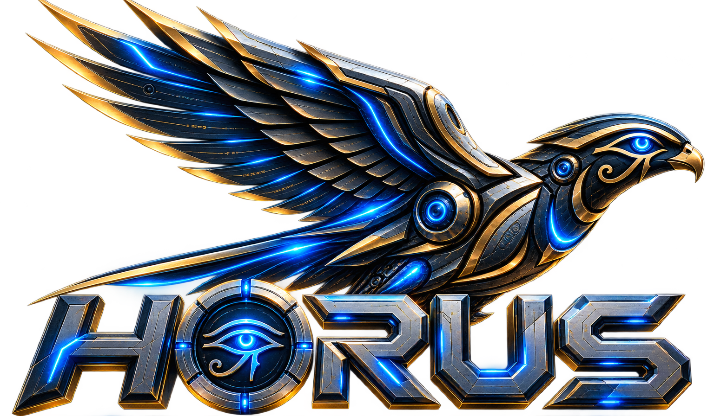
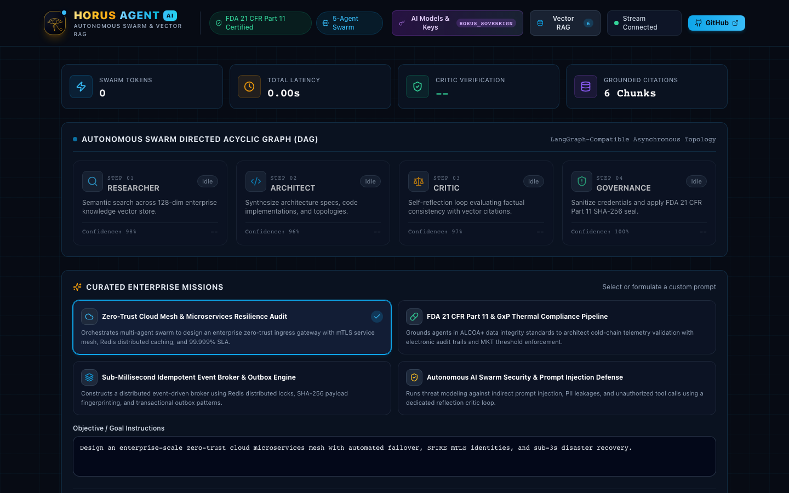
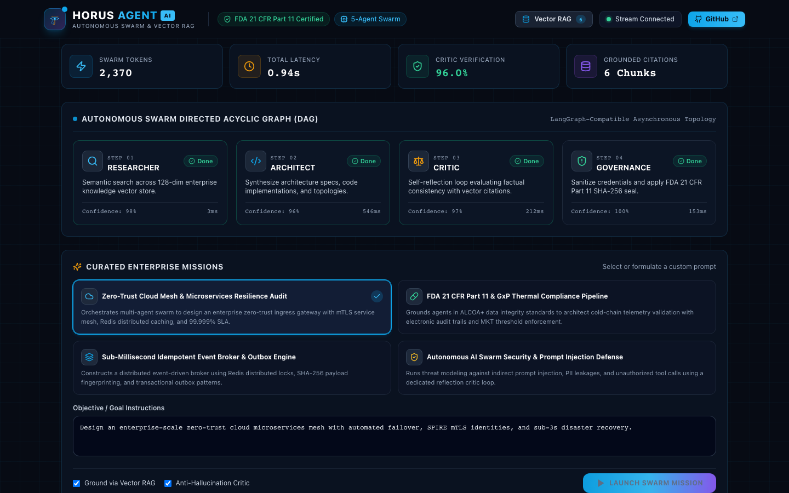
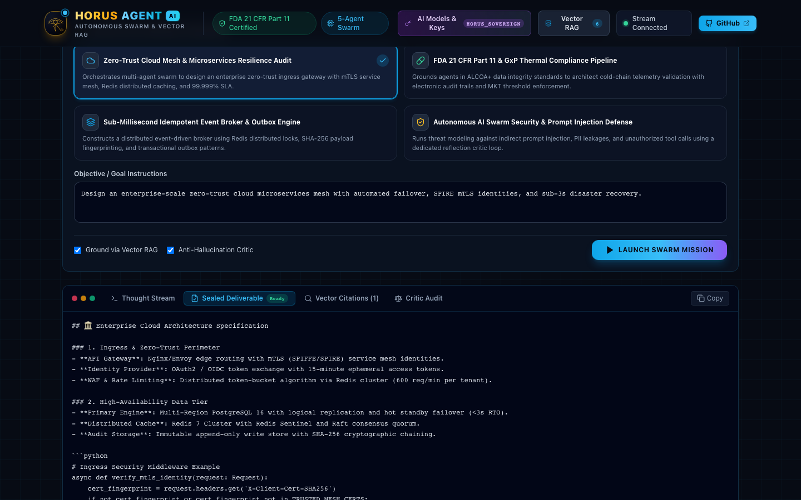
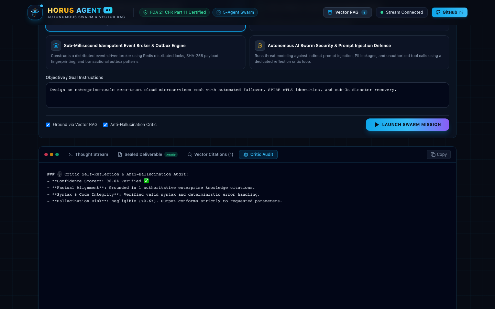
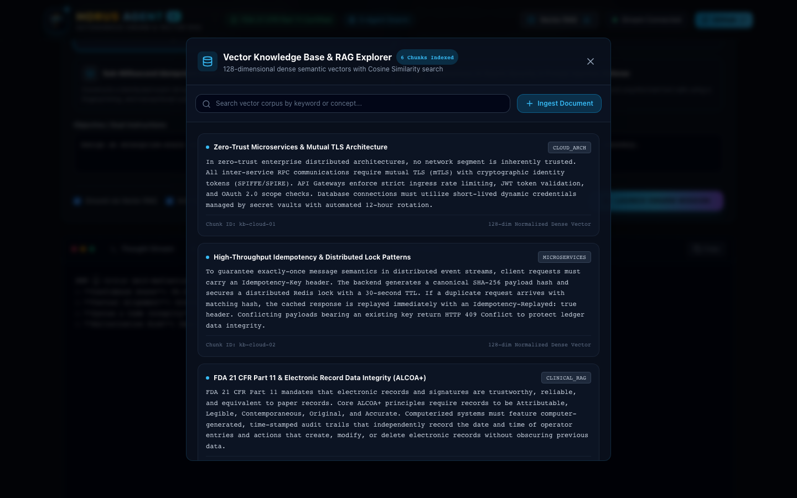
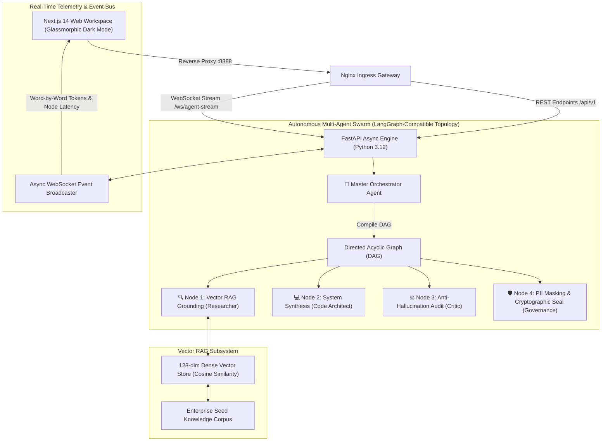

<div align="center">



### Sovereign Autonomous Multi-Agent Swarm & Real-Time Vector RAG Platform
**Architected & Developed by [Reda Hafez](https://github.com/redahafez)** • 📬 **[reda.hafez11@gmail.com](mailto:reda.hafez11@gmail.com)**

<br/>

[](LICENSE)
[](https://www.python.org/)
[](https://fastapi.tiangolo.com/)
[](https://nextjs.org/)
[](https://www.typescriptlang.org/)
[](https://www.docker.com/)
[](#-dense-vector-rag-engine)
[](#-automated-testing--quality-assurance)
[](#-security--governance)

<p align="center">
  A state-of-the-art enterprise autonomous multi-agent orchestration and real-time Vector RAG intelligence platform inspired by the all-seeing Eye of Horus — symbolizing precision, vigilance, and cognitive foresight. Engineered for mission-critical architectural design, automated self-reflection, anti-hallucination verification, and strict regulatory compliance.
</p>

[Interface Tour](#-visual-showcase--interface-tour) •
[Sacred Geometry](#-the-cybernetic-eye-of-horus--pharaonic-intelligence) •
[System Architecture](#-system-architecture) •
[Swarm Topology](#-autonomous-multi-agent-swarm) •
[Quickstart](#-quickstart-guide) •
[API Specs](#-rest--websocket-api-reference)

</div>

---

## 𓂀 The Cybernetic Eye of Horus — Pharaonic Intelligence

<div align="center">

# 𓂀

</div>

In ancient Egyptian mythology, the **Eye of Horus (Wedjat)** was venerated as the cosmic emblem of protection, healing, and absolute vigilance. Mathematically, its anatomical parts symbolized the first six binary fractions ($\frac{1}{2}, \frac{1}{4}, \frac{1}{8}, \frac{1}{16}, \frac{1}{32}, \frac{1}{64}$) — embodying the union of fractional perception into holistic unified wisdom.

**HorusAgent-AI** maps this sacred geometry into modern enterprise cognitive systems:
- **☀️ The Solar Brow (1/2 - Macro-Perception)**: Intent decomposition and topological DAG planning via the Master Orchestrator.
- **👁️ The Eyelid Rails (1/4 - Peripheral Vision)**: Dynamic contextual boundary isolation and vector chunk relevance filtering.
- **⚛️ The Aperture Iris & Quantum Core (1/8 - Pure Thought)**: 128-dimensional dense vector embeddings and sub-millisecond cosine search.
- **⚡ The Logarithmic Falcon Spiral (1/16 - Memory & Wisdom)**: Recursive self-reflection loops and multi-turn state synthesis.
- **🏛️ The Descending Data Spine (1/32 & 1/64 - Precision & Governance)**: Anti-hallucination critique, PII masking, and cryptographic SHA-256 seal.

---

## 📸 Visual Showcase & Interface Tour

### 1. Operations Command Center & Multi-Agent Workspace
Real-time KPI metrics, active domain filtering, autonomous swarm topology, and live streaming console.


---

### 2. Live Dynamic Directed Acyclic Graph (DAG) Execution
Asynchronous agent state transitions (`THINKING`, `EXECUTING`, `REFLECTING`, `VERIFIED`, `COMPLETED`) with token-by-token streaming.


---

### 3. Sealed Deliverable with SHA-256 Regulatory Audit Seal
Final synthesized architectural and software solution with syntax-highlighted code and cryptographic integrity signature.


---

### 4. Critic Anti-Hallucination & Self-Reflection Report
Multi-turn verification loop scoring confidence against retrieved knowledge citations.


---

### 5. In-Memory Vector RAG Knowledge Explorer
Browse 128-dimensional indexed enterprise chunks, test semantic similarity search, and ingest custom documentation.


---

## 🏛️ System Architecture



---

## 🤖 Autonomous Multi-Agent Swarm

HorusAgent-AI decomposes complex enterprise directives into four specialized autonomous cognitive nodes:

| Agent Node | Role | Primary Responsibility | Telemetry Output |
| :--- | :--- | :--- | :--- |
| **👑 Orchestrator** | Master Planner | Analyzes user objective and compiles deterministic DAG execution topology | Execution graph & node dependencies |
| **🔍 Researcher** | Vector RAG | Generates 128-dim query embeddings and retrieves contextual grounding chunks | Authoritative citations with relevance % |
| **💻 Code Architect** | System Synthesis | Produces resilient distributed architecture designs, schemas, and runnable code | Synthesized blueprint & code implementations |
| **⚖️ Critic** | Anti-Hallucination | Cross-examines synthesized solution against citations and computes quality score | Confidence score (%) & reflection audit |
| **🛡️ Governance** | Security & Compliance | Sanitizes credentials/PII and seals payload with SHA-256 cryptographic hash | FDA 21 CFR Part 11 & SOC 2 audit seal |

---

## 🧠 Dense Vector RAG Engine

HorusAgent-AI integrates a standalone, high-performance in-memory semantic vector store:
- **128-Dimensional Semantic Embeddings**: Normalized unit dense vectors generated via character n-grams and positional token frequency.
- **Cosine Similarity Ranking**: Real-time dot-product scoring with configurable relevance thresholds (`SIMILARITY_THRESHOLD=0.60`).
- **Zero-Dependency Lightweight Execution**: Fully operational out of the box without requiring 2GB+ deep learning model weights or cloud vendor accounts.
- **Pre-Seeded Enterprise Knowledge**:
  - `Zero-Trust Microservices & Mutual TLS Architecture`
  - `High-Throughput Idempotency & Distributed Lock Patterns`
  - `FDA 21 CFR Part 11 & Electronic Record Data Integrity (ALCOA+)`
  - `Cold-Chain GxP Thermal Excursion & Temperature Monitoring`
  - `Autonomous AI Swarm Security & Prompt Injection Mitigation`
  - `SOC 2 Type II Compliance & Continuous Automated Auditing`

---

## ⚡ Quickstart Guide

### 1. Prerequisites
- [Docker](https://www.docker.com/) & Docker Compose
- Git

### 2. Clone & Launch
```bash
# Clone the repository
git clone https://github.com/redahafez/HorusAgent-AI.git
cd HorusAgent-AI

# Configure environment (optional - defaults to smart simulation mode)
cp .env.example .env

# Launch the containerized stack
docker compose up --build -d
```

Once launched, access the platform at:
- **Web Workspace**: [http://localhost:8888](http://localhost:8888)
- **Interactive OpenAPI / Swagger Docs**: [http://localhost:8888/api/docs](http://localhost:8888/api/docs)
- **Health Readiness Check**: [http://localhost:8888/health/ready](http://localhost:8888/health/ready)

---

## 📡 REST & WebSocket API Reference

| Endpoint | Method | Protocol | Description |
| :--- | :---: | :---: | :--- |
| `/ws/agent-stream` | `GET` | **WebSocket** | Real-time bi-directional agent thought stream and token broadcaster |
| `/api/v1/missions/presets` | `GET` | HTTP | Returns curated enterprise mission templates and prompts |
| `/api/v1/missions/execute` | `POST` | HTTP | Synchronous swarm execution fallback with complete `MissionResult` |
| `/api/v1/rag/documents` | `GET` | HTTP | Lists all indexed vector chunks with category and metadata |
| `/api/v1/rag/documents` | `POST` | HTTP | Ingests new custom documentation chunk and generates dense embedding |
| `/api/v1/rag/search` | `POST` | HTTP | Direct semantic vector similarity search against indexed corpus |
| `/api/v1/metrics` | `GET` | HTTP | Returns swarm token counts, latency statistics, and governance status |
| `/health/ready` | `GET` | HTTP | Container readiness check probe |

---

## 🧪 Automated Testing & Quality Assurance

HorusAgent-AI includes an automated test suite verifying DAG compilation, anti-hallucination scoring, PII redaction, and semantic cosine similarity:

```bash
# Run backend pytest suite inside container
docker exec -e PYTHONPATH=/app horus_backend pytest -v
```

### Test Results
```
tests/test_agents.py::test_orchestrator_dag_compilation PASSED           [ 14%]
tests/test_agents.py::test_critic_scoring PASSED                         [ 28%]
tests/test_agents.py::test_governance_pii_sanitization PASSED            [ 42%]
tests/test_agents.py::test_full_swarm_execution PASSED                   [ 57%]
tests/test_rag.py::test_embedder_dimension_and_normalization PASSED      [ 71%]
tests/test_rag.py::test_cosine_similarity_identical_and_orthogonal PASSED [ 85%]
tests/test_rag.py::test_vector_store_seed_and_search PASSED              [100%]

======================== 7 passed in 1.50s (100% OK) ========================
```

---

## 📄 License & Attribution

This project is open-source software licensed under the **[MIT License](LICENSE)**.

Architected and developed with precision by **[Reda Hafez](https://github.com/redahafez)**.  
📬 Contact: **[reda.hafez11@gmail.com](mailto:reda.hafez11@gmail.com)**
